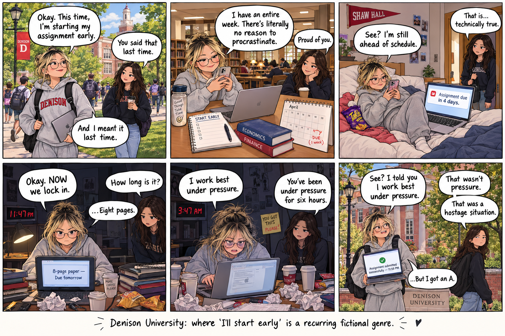

# Comic & Storytelling

## The Artifact

## Story Concept
What is the story about?
The comic is about a college student who keeps promising to start an assignment early but ends up procrastinating until the last minute. Despite the chaos, they manage to submit the assignment just before the deadline.

Who are the characters?
The main character is a sleep-deprived Denison student who is optimistic but constantly procrastinates. Their friend is more calm and sarcastic, commenting on the student’s choices.

What idea, feeling, or moment does the comic explore?
The comic explores the relatable cycle of procrastination and the pressure of college deadlines. It uses humor to show how students convince themselves that they have plenty of time, only to panic later.

## Process Notes
How did you make this?
I first developed the story around a common college experience: procrastinating on an assignment. I then divided the story into six panels showing the progression from confidence to panic and finally relief after receiving the grade.

What tools did you use?
I made this using ChatGPT for dialogue and DALL-E for comic strips. 

What decisions did you make about the panels, dialogue, pacing, and visual style?
I used six panels to create a clear beginning, buildup, climax, and ending. The dialogue becomes more chaotic as the deadline gets closer. I chose a colorful, hand-drawn comic style with expressive characters and Denison-inspired settings to make the story feel more personal and relatable to college students.

## Reflection
Respond to the comic and storytelling reflection prompt in 200–300 words.

The comic explores procrastination as a common part of college life, especially the funny contradiction between knowing that starting early is the responsible choice and still choosing to wait. I wanted the story to feel relatable, so I focused on small moments that students might recognize, such as sitting in the library in front of your laptop opening with the assignment but still scrolling on a phone, convincing yourself that being four days ahead is “still ahead,” and suddenly deciding to “lock in” at the last midnight of the assignment.

The six-panel structure helped me create a clear progression. The first panels establish the student’s confidence, while the middle panels gradually increase the pressure. Panel 4 is the turning point because the student finally realizes how much work they have left. Panel 5 shows the most chaotic moment, and Panel 6 provides the payoff when the assignment is submitted at 11:59 PM. The sarcastic friend acts almost like the audience, pointing out how ridiculous the situation has become. Overall, I wanted the comic to communicate that procrastination can be stressful, but it is also a funny and recognizable part of student life.

## Attribution & AI Use
- Tools used:
- AI prompts (summary):
- What AI generated:
- What you changed or decided:
